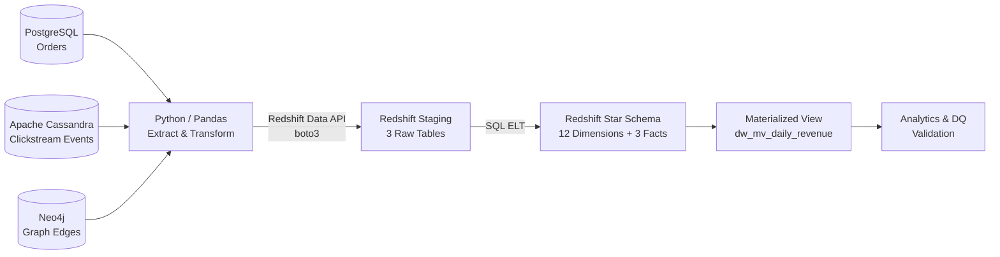

# E-Commerce Multi-Source Data Warehouse (Amazon Redshift)

An end-to-end **ETL/ELT data warehousing pipeline** that unifies three heterogeneous operational databases; **PostgreSQL** (orders), **Apache Cassandra** (clickstream events), and **Neo4j** (product recommendation graphs); into a centralized, Kimball-style **Star Schema** in **Amazon Redshift Serverless**.

## Architecture Overview

## Tech Stack
* **Cloud Data Warehouse:** Amazon Redshift Serverless (`boto3` Redshift Data API)
* **Operational Sources:** PostgreSQL (`psycopg2`, `SQLAlchemy`), Apache Cassandra (`cassandra-driver`), Neo4j (`neo4j` Bolt driver)
* **Data Engineering & Modeling:** Python, Pandas, NumPy, Kimball Dimensional Modeling (Star Schema, SCD Type 2 ready)

## Key Engineering Highlights
* **Polyglot Entity Resolution:** Conformed **7,057 unique customers** and **3,360 unique products** across relational, wide-column, and graph databases using `BIGINT IDENTITY(1,1)` surrogate keys.
* **Polymorphic Graph Flattening:** Resolved Neo4j's polymorphic `(from_node_id, to_node_id)` graph edges into four explicit role-playing foreign keys (`from_customer_sk`, `to_customer_sk`, `from_product_sk`, `to_product_sk`).
* **Data Hygiene & Standardization:** Harmonized ISO country code drift (`'UK'` → `'GB'`, 66 records), standardized uppercase/trimmed business keys, and eliminated 409 NULL campaign references.
* **Redshift Physical Optimization:** `DISTKEY(customer_sk)` on Orders/Events, `DISTKEY(to_product_sk)` on Graph Edges, `DISTSTYLE ALL` on `dw_dim_date` and 9 lookup dimensions, chronological `SORTKEY`s, `ENCODE zstd`, `ANALYZE` statistics, and a pre-aggregated Materialized View (`dw_mv_daily_revenue`).

## Validation & Performance Benchmark
* **Zero Data Loss:** 100% row completeness verified from Staging → Fact tables (`2,500` Orders, `2,500` Events, `2,500` Graph Edges).
* **Data Quality Gate:** 8/8 automated checks passed (`0` duplicate primary keys, `0` NULL foreign keys, `0` orphan referential integrity violations).
* **Before vs. After Optimization:** With session result caching disabled, querying `dw_mv_daily_revenue` reduced Redshift server-side execution time from **453.0 ms** to **223.51 ms** (**50.7% faster**) while returning identical Top-10 daily revenue results.

## Repository Contents
* [`ecommerce_dwh_pipeline.ipynb`](ecommerce_dwh_pipeline.ipynb) — Full executed notebook (Tasks 1–6)
* [`warehouse_report.md`](warehouse_report.md) — Executive report with Mermaid ERD, DQ results, benchmark, and example SQL
* [`project-ddl-long.md`](project-ddl-long.md) — Complete Redshift Star Schema DDL
* [`project-mermaid-diagram.md`](project-mermaid-diagram.md) — Full column-level Star Schema ERD
* `data/` — Sample CSV datasets for PostgreSQL, Cassandra, and Neo4j
