# E-Commerce Data Warehouse Build Report

**Generated:** 2026-11-22 21:23:41 UTC  
**Target Platform:** Amazon Redshift (`ecom` / Workgroup `udacity-dwh-wg`)  
**Integrated Sources:** PostgreSQL (Orders), Apache Cassandra (Clickstream Events), Neo4j (Graph Relationships)

---

## 1. Executive Summary
This project unifies three heterogeneous operational databases—**PostgreSQL**, **Apache Cassandra**, and **Neo4j**—into a centralized, Kimball-style **Star Schema** in **Amazon Redshift**. The pipeline enforces strict data hygiene (standardizing ISO country codes `'UK'` -> `'GB'`, resolving polymorphic graph nodes into explicit role-playing foreign keys, and cleaning null campaign values) while preserving **100% row completeness** (2,500 rows per source) from staging to final fact tables.

---

## 2. Warehouse Schema Diagram (Mermaid.js ERD)

```mermaid
erDiagram
    %% =========================
    %% DIMENSIONS
    %% =========================
    dw_dim_date {
      INT date_key PK "yyyymmdd"
      DATE date_actual
      SMALLINT year
      SMALLINT quarter
      SMALLINT month
      SMALLINT day
      SMALLINT week_of_year
      SMALLINT day_of_week
      BOOLEAN is_weekend
    }

    dw_dim_customer {
      BIGINT customer_sk PK
      VARCHAR customer_id
      VARCHAR country
      VARCHAR state
      VARCHAR customer_segment
      BOOLEAN is_logged_in
      TIMESTAMP effective_from
      TIMESTAMP effective_to
      BOOLEAN is_current
    }

    dw_dim_product {
      BIGINT product_sk PK
      VARCHAR product_id
      VARCHAR category
      VARCHAR price_bucket
      DECIMAL current_unit_price_usd
      TIMESTAMP effective_from
      TIMESTAMP effective_to
      BOOLEAN is_current
    }

    dw_dim_campaign    { BIGINT campaign_sk PK  VARCHAR campaign }
    dw_dim_channel     { BIGINT channel_sk  PK  VARCHAR channel }
    dw_dim_device      { BIGINT device_sk   PK  VARCHAR device_type }
    dw_dim_browser     { BIGINT browser_sk  PK  VARCHAR browser }
    dw_dim_os          { BIGINT os_sk       PK  VARCHAR os }
    dw_dim_referrer    { BIGINT referrer_sk PK  VARCHAR referrer }
    dw_dim_shipmethod  { BIGINT shipping_method_sk PK VARCHAR shipping_method }
    dw_dim_paymethod   { BIGINT payment_method_sk  PK VARCHAR payment_method }
    dw_dim_ab_variant  { BIGINT ab_variant_sk PK VARCHAR ab_variant }

    %% =========================
    %% FACTS
    %% =========================
    dw_fact_orders {
      BIGINT order_sk PK
      VARCHAR order_id
      BIGINT customer_sk FK
      INT    order_date_key FK
      INT    ship_date_key  FK
      BIGINT channel_sk FK
      BIGINT device_sk  FK
      BIGINT browser_sk FK
      BIGINT campaign_sk FK
      BIGINT payment_method_sk FK
      BIGINT shipping_method_sk FK
      VARCHAR primary_category
      INT    num_distinct_items
      DECIMAL subtotal_usd
      DECIMAL discount_rate
      DECIMAL discount_amount_usd
      DECIMAL shipping_cost_usd
      DECIMAL tax_rate
      DECIMAL tax_amount_usd
      DECIMAL order_total_usd
      DECIMAL order_weight_kg
      INT    delivery_days
      BOOLEAN on_time_delivery
      BOOLEAN authorization_approved
      BOOLEAN returned
    }

    dw_fact_events {
      BIGINT event_sk PK
      VARCHAR event_id
      BIGINT customer_sk FK
      BIGINT product_sk  FK
      INT    event_date_key FK
      VARCHAR session_id
      VARCHAR event_type
      BIGINT channel_sk  FK
      BIGINT device_sk   FK
      BIGINT browser_sk  FK
      BIGINT os_sk       FK
      BIGINT referrer_sk FK
      BIGINT ab_variant_sk FK
      INT    page_depth
      INT    latency_ms
      INT    dwell_seconds
      DECIMAL cart_value_usd
      DECIMAL discount_rate
      DECIMAL fraud_score
      VARCHAR payment_outcome
      INT    sequence_num
      VARCHAR category
      VARCHAR promo_code
    }

    dw_fact_graph_edges {
      BIGINT edge_sk PK
      VARCHAR edge_id
      INT    event_date_key FK
      VARCHAR relationship

      BIGINT from_customer_sk FK
      BIGINT to_customer_sk   FK
      BIGINT from_product_sk  FK
      BIGINT to_product_sk    FK

      VARCHAR order_id
      VARCHAR category
      BIGINT  campaign_sk FK
      VARCHAR customer_segment
      VARCHAR region
      VARCHAR state

      DECIMAL edge_strength
      VARCHAR price_bucket
      INT     prior_interactions
      INT     dwell_seconds
      DECIMAL unit_price_usd
      INT     quantity
      BOOLEAN returned_flag
      BOOLEAN auth_approved
    }

    %% =========================
    %% RELATIONSHIPS
    %% =========================
    dw_dim_date ||--o{ dw_fact_orders : "order_date_key"
    dw_dim_date ||--o{ dw_fact_orders : "ship_date_key"
    dw_dim_date ||--o{ dw_fact_events : "event_date_key"
    dw_dim_date ||--o{ dw_fact_graph_edges : "event_date_key"

    dw_dim_customer ||--o{ dw_fact_orders : "customer_sk"
    dw_dim_customer ||--o{ dw_fact_events : "customer_sk"
    dw_dim_customer ||--o{ dw_fact_graph_edges : "from_customer_sk"
    dw_dim_customer ||--o{ dw_fact_graph_edges : "to_customer_sk"

    dw_dim_product ||--o{ dw_fact_events : "product_sk"
    dw_dim_product ||--o{ dw_fact_graph_edges : "from_product_sk"
    dw_dim_product ||--o{ dw_fact_graph_edges : "to_product_sk"

    dw_dim_campaign ||--o{ dw_fact_orders : "campaign_sk"
    dw_dim_campaign ||--o{ dw_fact_graph_edges : "campaign_sk"

    dw_dim_channel ||--o{ dw_fact_orders : "channel_sk"
    dw_dim_channel ||--o{ dw_fact_events : "channel_sk"

    dw_dim_device ||--o{ dw_fact_orders : "device_sk"
    dw_dim_device ||--o{ dw_fact_events : "device_sk"

    dw_dim_browser ||--o{ dw_fact_orders : "browser_sk"
    dw_dim_browser ||--o{ dw_fact_events : "browser_sk"

    dw_dim_os ||--o{ dw_fact_events : "os_sk"
    dw_dim_referrer ||--o{ dw_fact_events : "referrer_sk"
    dw_dim_ab_variant ||--o{ dw_fact_events : "ab_variant_sk"

    dw_dim_shipmethod ||--o{ dw_fact_orders : "shipping_method_sk"
    dw_dim_paymethod  ||--o{ dw_fact_orders : "payment_method_sk"
```



---

## 3. Table Inventory & Row Counts

| layer | table_name | row_count |
| --- | --- | --- |
| Dimension | dw_dim_ab_variant | 2 |
| Dimension | dw_dim_browser | 5 |
| Dimension | dw_dim_campaign | 7 |
| Dimension | dw_dim_channel | 5 |
| Dimension | dw_dim_customer | 7057 |
| Dimension | dw_dim_date | 552 |
| Dimension | dw_dim_device | 3 |
| Dimension | dw_dim_os | 5 |
| Dimension | dw_dim_payment_method | 5 |
| Dimension | dw_dim_product | 3360 |
| Dimension | dw_dim_referrer | 6 |
| Dimension | dw_dim_shipping_method | 3 |
| Fact | dw_fact_events | 2500 |
| Fact | dw_fact_graph_edges | 2500 |
| Fact | dw_fact_orders | 2500 |
| OLAP MV | dw_mv_daily_revenue | 542 |
| Staging | stg_edges_raw | 2500 |
| Staging | stg_events_raw | 2500 |
| Staging | stg_orders_raw | 2500 |

---

## 4. Data Quality & Referential Integrity Validation

| check_name | issue_count | status |
| --- | --- | --- |
| Duplicate order_id in dw_fact_orders | 0 | ✅ PASS |
| Duplicate event_id in dw_fact_events | 0 | ✅ PASS |
| Orphan customer_sk in dw_fact_orders (no dim_customer match) | 0 | ✅ PASS |
| Orphan order_date_key in dw_fact_orders (no dim_date match) | 0 | ✅ PASS |
| NULL customer_sk in dw_fact_orders | 0 | ✅ PASS |
| Duplicate edge_id in dw_fact_graph_edges | 0 | ✅ PASS |
| NULL order_date_key in dw_fact_orders | 0 | ✅ PASS |
| NULL customer_sk in dw_fact_events | 0 | ✅ PASS |

---

## 5. Design Rationale & Redshift Optimization Strategy

1. **Why Star Schema (Kimball Methodology)?**  
   Separating quantitative measures into three grain-pure fact tables (`dw_fact_orders`, `dw_fact_events`, `dw_fact_graph_edges`) and descriptive attributes into 12 conformed dimensions (`dw_dim_customer`, `dw_dim_product`, `dw_dim_date`, and 9 lookup dimensions) simplifies BI joins and guarantees consistent KPIs across teams.
2. **Distribution Strategy (`DISTKEY` vs. `DISTSTYLE ALL`):**  
   - `dw_fact_orders` and `dw_fact_events` share `DISTKEY(customer_sk)` to collocate customer records on the same compute node, eliminating network shuffling during Customer-360 and funnel joins.
   - `dw_fact_graph_edges` uses `DISTKEY(to_product_sk)` to optimize product co-purchase (`ALSO_BOUGHT_WITH`) and recommendation queries.
   - `dw_dim_date` and all 9 small lookup dimensions use `DISTSTYLE ALL` for instant local broadcast joins.
3. **Sort Keys & Compression:**  
   All fact tables use chronological `SORTKEY`s (`order_date_key`, `event_date_key`) so Redshift Zone Maps skip irrelevant disk blocks during date-range filtering. `ENCODE zstd` minimizes storage footprint and I/O.
4. **OLAP Materialized View & Statistics:**  
   `public.dw_mv_daily_revenue` pre-aggregates daily order counts, revenue, and AOV, and `ANALYZE` was executed across all core fact and dimension tables to keep the Redshift Query Optimizer accurate.

---

## 6. Performance Optimization Benchmark (Before vs. After)

To demonstrate the impact of the `dw_mv_daily_revenue` Materialized View, we disabled session result caching (`SET enable_result_cache_for_session TO OFF`) and ran the exact same Top-10 Daily Revenue aggregation directly against `dw_fact_orders` (Before) and against `dw_mv_daily_revenue` (After).

### Benchmark Results
| Version | Rows_Returned | Redshift_Server_ms | API_Wall_Clock_sec |
| --- | --- | --- | --- |
| BEFORE: Base Fact Table (dw_fact_orders + GROUP BY) | 10 | 453.0 | 1.278 |
| AFTER: Materialized View (dw_mv_daily_revenue) | 10 | 223.51 | 0.98 |

* **Equivalent Output Verified:** `True` (both queries return identical Top-10 revenue days).
* **Analysis:** The Materialized View avoids scanning and grouping all 2,500 base fact rows on every request by reading 542 pre-aggregated daily rows. While Redshift Data API polling adds fixed network overhead (~1s wall-clock), Redshift's server-side execution time dropped from **453.0 ms** to **223.51 ms**, and this pre-aggregation advantage scales linearly as order volume grows into millions of rows.

### Before SQL (Direct Fact-to-Dimension Aggregation)
```sql
SELECT
    d.date_actual,
    d.year,
    d.quarter,
    d.is_weekend,
    COUNT(*)                     AS orders,
    ROUND(SUM(f.order_total_usd), 2) AS revenue_usd,
    ROUND(AVG(f.order_total_usd), 2) AS avg_order_value
FROM public.dw_fact_orders f
JOIN public.dw_dim_date d ON d.date_key = f.order_date_key
GROUP BY d.date_actual, d.year, d.quarter, d.is_weekend
ORDER BY revenue_usd DESC
LIMIT 10;
```

### After SQL (Optimized Materialized View Query)
```sql
SELECT
    d.date_actual,
    d.year,
    d.quarter,
    d.is_weekend,
    mv.orders,
    ROUND(mv.revenue_usd, 2)     AS revenue_usd,
    ROUND(mv.avg_order_value, 2) AS avg_order_value
FROM public.dw_mv_daily_revenue mv
JOIN public.dw_dim_date d ON d.date_key = mv.order_date_key
ORDER BY mv.revenue_usd DESC
LIMIT 10;
```

### Returned Top-10 Daily Revenue Sample
| date_actual | year | quarter | is_weekend | orders | revenue_usd | avg_order_value |
| --- | --- | --- | --- | --- | --- | --- |
| 2025-04-26 | 2025 | 2 | True | 9 | 10005.75 | 1111.75 |
| 2024-04-27 | 2024 | 2 | True | 11 | 8379.88 | 761.80 |
| 2025-01-05 | 2025 | 1 | True | 8 | 7753.02 | 969.12 |
| 2024-04-17 | 2024 | 2 | False | 9 | 7488.27 | 832.03 |
| 2025-03-14 | 2025 | 1 | False | 7 | 7029.01 | 1004.14 |
| 2024-01-14 | 2024 | 1 | True | 5 | 6938.24 | 1387.64 |
| 2024-09-16 | 2024 | 3 | False | 2 | 6434.74 | 3217.37 |
| 2024-02-16 | 2024 | 1 | False | 7 | 6055.87 | 865.12 |
| 2024-07-25 | 2024 | 3 | False | 8 | 6023.05 | 752.88 |
| 2024-12-28 | 2024 | 4 | True | 7 | 5970.72 | 852.96 |

---

## 7. Example Analytical Queries & Results

### Example 1: E-Commerce Performance by Sales Channel (`dw_fact_orders` JOIN `dw_dim_channel`)
This query joins the Orders fact table to the broadcast-distributed Channel dimension (`DISTSTYLE ALL`) to compare revenue, average order value, fulfillment speed, and return rates across sales channels.

```sql
SELECT
    ch.channel,
    COUNT(*)                                                                 AS total_orders,
    ROUND(SUM(f.order_total_usd), 2)                                         AS total_revenue_usd,
    ROUND(AVG(f.order_total_usd), 2)                                         AS avg_order_value,
    ROUND(AVG(f.delivery_days::DECIMAL(10,2)), 2)                            AS avg_delivery_days,
    ROUND(100.0 * SUM(CASE WHEN f.returned THEN 1 ELSE 0 END) / COUNT(*), 2) AS return_rate_pct
FROM public.dw_fact_orders f
JOIN public.dw_dim_channel ch ON ch.channel_sk = f.channel_sk
GROUP BY ch.channel
ORDER BY total_revenue_usd DESC;
```

**Query Result:**
| channel | total_orders | total_revenue_usd | avg_order_value | avg_delivery_days | return_rate_pct |
| --- | --- | --- | --- | --- | --- |
| android_app | 535 | 224060.04 | 418.80 | 3.87 | 14.58 |
| ios_app | 498 | 221419.83 | 444.61 | 3.99 | 13.86 |
| web | 500 | 205995.94 | 411.99 | 4.00 | 20.40 |
| marketplace | 490 | 199147.95 | 406.42 | 3.85 | 16.73 |
| mobile_web | 477 | 188793.93 | 395.79 | 3.89 | 16.98 |

**Insight:** Mobile apps (`android_app` and `ios_app`) drive the highest total revenue ($224K and $221K) and maintain the lowest return rates (13.86%–14.58%), whereas `web` shows a noticeably higher return rate (20.40%) despite similar delivery times (~4 days).

---

### Example 2: Graph Relationship Activity (`dw_fact_graph_edges`)
This query summarizes flattened Neo4j graph edges stored in Redshift to evaluate customer-to-product and product-to-product engagement across relationship types.

```sql
SELECT
    g.relationship,
    COUNT(*)                        AS total_edges,
    COUNT(DISTINCT g.to_product_sk) AS distinct_target_products,
    ROUND(AVG(g.edge_strength), 3)  AS avg_edge_strength,
    ROUND(AVG(g.unit_price_usd), 2) AS avg_unit_price_usd
FROM public.dw_fact_graph_edges g
GROUP BY g.relationship
ORDER BY total_edges DESC;
```

**Query Result:**
| relationship | total_edges | distinct_target_products | avg_edge_strength | avg_unit_price_usd |
| --- | --- | --- | --- | --- |
| VIEWED | 830 | 789 | 0.555 | 138.60 |
| PURCHASED | 469 | 458 | 0.551 | 140.36 |
| ADDED_TO_CART | 441 | 430 | 0.533 | 149.58 |
| ALSO_BOUGHT_WITH | 393 | 382 | 0.546 | 143.13 |
| REFERRED_FRIEND | 256 | 0 | 0.532 | 138.18 |
| RETURNS | 111 | 110 | 0.555 | 165.03 |

**Insight:** `VIEWED` (830 edges) and `PURCHASED` (469 edges) dominate graph activity, while `RETURNS` edges correlate with the highest average unit price ($165.03), highlighting higher-ticket items as a key focus area for return reduction.

---

## 8. All Query Execution Metrics
| Query | Rows_Returned | Server_Time_ms | Wall_Time_Sec |
| --- | --- | --- | --- |
| Q1a: Daily Revenue (Base Fact Table - BEFORE) | 10 | 453.0 | 1.278 |
| Q1b: Daily Revenue (Materialized View - AFTER) | 10 | 223.51 | 0.98 |
| Q2: Channel Revenue & Return Rate | 5 | 382.45 | 1.273 |
| Q3: Graph Relationship Analytics | 6 | 457.52 | 1.304 |

---

## 9. Analytics Capabilities Supported
- **Executive Revenue & Margin Tracking:** Instant daily/quarterly revenue, discount impact, and AOV reporting via `dw_mv_daily_revenue` and `dw_dim_date`.
- **Omnichannel & Fulfillment Analytics:** Compare conversion, delivery speed, and return rates across web, mobile apps, and marketplaces.
- **Clickstream Funnel & Fraud Monitoring:** Analyze session depth, latency, A/B test variants, and fraud scores alongside completed orders.
- **Graph-Driven Personalization:** Measure `ALSO_BOUGHT_WITH`, `REFERRED_FRIEND`, and `VIEWED` product affinity directly inside SQL BI tools.
